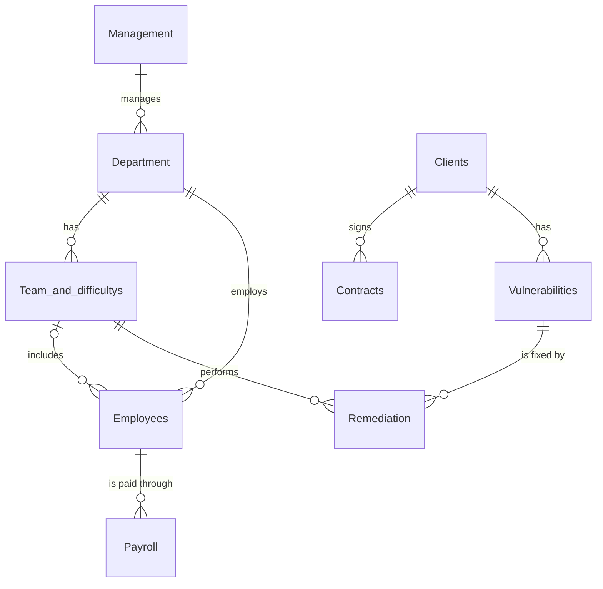

# Salem Cybersecurity Company – Relational Database (SQL)

A relational database designed for a fictional cybersecurity company, **Salem**. It stores the company's organizational structure (management, departments, teams, employees, payroll), its **clients and contracts**, and the full **vulnerability lifecycle**: from discovering a vulnerability at a client to recording how it was fixed and by which team.

> **Project type:** Academic project
> **Database system:** MySQL
> **Author:** Ali Abdulrahman Alghamdi – AI Diploma student, Al-Baha University

---

## 📌 Project Overview

Cybersecurity companies need to answer questions such as:

- Which vulnerabilities were found at each client, and how severe are they?
- Which team fixed each vulnerability, when, and using what method?
- How many critical, high, medium, and low vulnerabilities does each team handle?
- How much does the company spend on payroll?

This project designs a database that answers these questions, using **9 linked tables**, data-integrity constraints, realistic sample data, and a set of analytical SQL queries.

---

## 🗺️ Entity-Relationship Diagram



---

## 🗂️ Database Structure

The database `Salem_Cybersecurity_Company` contains **9 tables** connected through primary and foreign keys.

| # | Table | Purpose | Primary Key | Foreign Keys |
|---|-------|---------|-------------|--------------|
| 1 | `Management` | Company managers | `MGT_id` | – |
| 2 | `Department` | Company departments (Network Security, Application Security, Data Security, Law, Accounting) | `Dep_ID` | `MGT_ID` → `Management` |
| 3 | `Team_and_difficultys` | Technical teams, including a count of vulnerabilities by severity (Critical / High / Medium / Low) | `Team_ID` | `Dep_ID` → `Department` |
| 4 | `Clients` | Client companies and their industry/service category | `commercial_register_id` | – |
| 5 | `Employees` | Employees, their specialty, department, and (optional) team | `Emp_ID` | `Dep_ID` → `Department`, `Team_ID` → `Team_and_difficultys` |
| 6 | `Payroll` | Monthly salary records (basic salary + allowances) | `Payroll_ID` (AUTO_INCREMENT) | `Emp_ID` → `Employees` |
| 7 | `Contracts` | Contracts signed with clients, with start/end dates and legal terms | `Contract_ID` | `commercial_register_id` → `Clients` |
| 8 | `Vulnerabilities` | Security vulnerabilities discovered at clients | `Vuln_ID` | `commercial_register_id` → `Clients` |
| 9 | `Remediation` | How and when each vulnerability was fixed, and by which team | `Fix_ID` | `Vuln_ID` → `Vulnerabilities`, `Team_ID` → `Team_and_difficultys` |

### Relationships

- **Management → Department** (one-to-many): each department is led by one manager.
- **Department → Team_and_difficultys** (one-to-many): each team belongs to a technical department.
- **Department → Employees** (one-to-many): every employee belongs to a department.
- **Team_and_difficultys → Employees** (one-to-many, optional): team members are linked to a team; managers and non-technical staff have `Team_ID = NULL`.
- **Employees → Payroll** (one-to-many): each employee has one payroll record per month.
- **Clients → Contracts** (one-to-many): a client can sign contracts.
- **Clients → Vulnerabilities** (one-to-many): vulnerabilities are discovered at a specific client.
- **Vulnerabilities → Remediation** (one-to-many): each vulnerability is fixed with a recorded method.
- **Team_and_difficultys → Remediation** (one-to-many): each fix is performed by a team.

---

## 🔒 Data Integrity & Constraints

| Constraint | Where it is used | Why |
|-----------|------------------|-----|
| **PRIMARY KEY** | All 9 tables | Uniquely identifies every record |
| **FOREIGN KEY** | Between related tables (see above) | Prevents orphan records, e.g. a fix linked to a non-existent vulnerability |
| **NOT NULL** | Names, dates, salaries, severity, fix method, and all foreign keys | Ensures required data is always present |
| **CHECK** | `Contracts`: `CHECK (End_Date >= Start_Date)` | A contract can never end before it starts |
| **ENUM** | `Vulnerabilities.Severity` → `'Low'`, `'Medium'`, `'High'`, `'Critical'` | Restricts severity to valid, standard levels |
| **AUTO_INCREMENT** | `Payroll.Payroll_ID` | Automatically generates payroll record IDs |
| **DECIMAL(10,2)** | `Basic_Salary`, `Allowances` | Accurate monetary values |
| **BIGINT** | `Clients.commercial_register_id` | Large commercial register numbers that do not fit in `INT` |

---

## 🧪 Sample Data

Each table was populated with sample data using `INSERT` statements:

| Table | Records |
|-------|---------|
| Management | 5 |
| Department | 5 |
| Team_and_difficultys | 3 |
| Clients | 9 |
| Employees | 15 |
| Payroll | 25 (January and February 2026) |
| Contracts | 9 (2021 – 2026) |
| Vulnerabilities | 9 (covering SQL Injection, MITM, ARP Spoofing, Input Validation, Rogue Access Point, Business Logic Attacks, Insecure Storage of Sensitive Data) |
| Remediation | 9 (one fix per vulnerability) |

All names, companies, and IDs are **fictional sample data**.

---

## 🔍 SQL Queries

### 1. Automatically update each team's vulnerability counts (`UPDATE` + `JOIN` + subqueries)

For each team, this counts the vulnerabilities by severity among the clients whose industry matches the team's department, then stamps `last_updated` with the current date.

```sql
UPDATE Team_and_difficultys t
JOIN Department d ON t.Dep_ID = d.Dep_ID
SET
  t.Difficulty_Critical = (SELECT COUNT(*) FROM Vulnerabilities v
                           JOIN Clients c ON v.commercial_register_id = c.commercial_register_id
                           WHERE v.Severity = 'Critical' AND c.Industry = d.Dep_Name),
  t.Difficulty_High     = (SELECT COUNT(*) FROM Vulnerabilities v
                           JOIN Clients c ON v.commercial_register_id = c.commercial_register_id
                           WHERE v.Severity = 'High' AND c.Industry = d.Dep_Name),
  t.Difficulty_Medium   = (SELECT COUNT(*) FROM Vulnerabilities v
                           JOIN Clients c ON v.commercial_register_id = c.commercial_register_id
                           WHERE v.Severity = 'Medium' AND c.Industry = d.Dep_Name),
  t.Difficulty_Low      = (SELECT COUNT(*) FROM Vulnerabilities v
                           JOIN Clients c ON v.commercial_register_id = c.commercial_register_id
                           WHERE v.Severity = 'Low' AND c.Industry = d.Dep_Name),
  t.last_updated = CURDATE();
```

**Result:** the teams start with all counts at `0`; after the update they reflect the real data.

| Team | Critical | High | Medium | Low |
|------|----------|------|--------|-----|
| Team khaled (Network Security) | 0 | 1 | 1 | 1 |
| Team salman (Application Security) | 0 | 1 | 2 | 0 |
| Team fahed (Data Security) | 1 | 2 | 0 | 0 |

### 2. Total vulnerabilities by severity (`SUM`)

```sql
SELECT SUM(Difficulty_Critical) AS Total_Critical,
       SUM(Difficulty_High)     AS Total_High,
       SUM(Difficulty_Medium)   AS Total_Medium,
       SUM(Difficulty_Low)      AS Total_Low
FROM Team_and_difficultys;
```

**Result:** Critical = 1, High = 4, Medium = 3, Low = 1.

### 3. Total number of vulnerabilities

```sql
SELECT SUM(Difficulty_Critical) + SUM(Difficulty_High)
     + SUM(Difficulty_Medium)   + SUM(Difficulty_Low) AS Total_Vulnerabilities
FROM Team_and_difficultys;
```

**Result:** 9 (matches the 9 rows in `Vulnerabilities`, which confirms the update in query 1 worked correctly).

### 4. Total payroll cost (`SUM`)

```sql
SELECT SUM(Basic_Salary + Allowances) AS Total_Payroll
FROM Payroll;
```

### 5. High and Critical vulnerabilities with their fixes (3-table `JOIN`, `IN`, `ORDER BY`)

```sql
SELECT c.Company_Name, v.Vuln_Name, v.Severity, r.Fix_Method, r.Fix_Date
FROM Vulnerabilities v
JOIN Clients c     ON v.commercial_register_id = c.commercial_register_id
JOIN Remediation r ON v.Vuln_ID = r.Vuln_ID
WHERE v.Severity IN ('High', 'Critical')
ORDER BY r.Fix_Date DESC;
```

**Result:** 5 rows, from the most recent fix to the oldest (Amazon, tecno, honor, google, dell).

### 6. Search employees by name (`LIKE`)

```sql
-- Names starting with "al"
SELECT * FROM Employees WHERE Emp_name LIKE 'al%';
```

---

## 📁 Repository Files

```
├── README.md      → Project documentation
└── schema.sql     → Database creation, tables, sample data, and queries
```

---

## ▶️ How to Run

1. Install **MySQL** and **MySQL Workbench**.
2. Open `schema.sql` in MySQL Workbench.
3. Run the whole script (⚡ Execute). It will:
   1. Create the database `Salem_Cybersecurity_Company` (and drop it first if it already exists)
   2. Create the 9 tables in the correct order (parents before children)
   3. Insert the sample data
   4. Run the `SELECT` and `UPDATE` queries

> ⚠️ The script starts with `DROP DATABASE IF EXISTS`, so it will delete any existing database with the same name.

---

## 🎯 What I Learned

- Designing a relational database from scratch, with correct table order and relationships
- Using constraints (`NOT NULL`, `CHECK`, `ENUM`, foreign keys) to protect data quality
- Writing `JOIN` queries across multiple tables and correlated subqueries
- Using `UPDATE` with `JOIN` to keep summary data in sync with the underlying records
- Documenting a project clearly with an ER diagram and example results

---

## 🚀 Possible Improvements

- Normalize `Team_and_difficultys` (replace the four severity columns with a query or a `VIEW`, so the counts are always up to date)
- Add `INDEX`es on foreign keys to speed up joins
- Add a `Projects`/`Assets` table to link vulnerabilities to specific client systems
- Add stored procedures for common tasks (e.g. registering a new vulnerability and its fix)
- Build a simple web dashboard on top of the database

---

## 👤 Author

**Ali Abdulrahman Alghamdi**
AI Diploma Student – Al-Baha University
📧 s86192565@gmail.com
